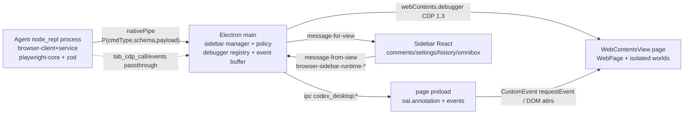
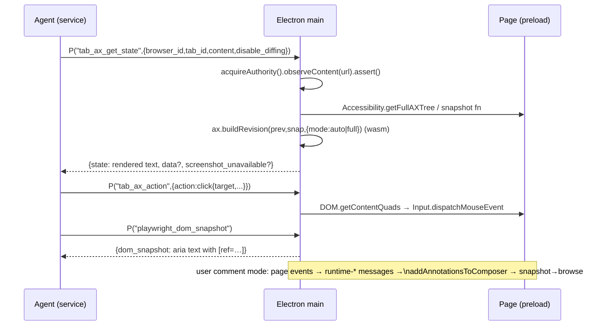

# SPEC — ChatGPT/Codex Desktop Internal Browser ("owl" IAB), 1:1 Replication Master Plan

Target: `D:\Projects\openAI code\OpenAI.Codex_26.1021.3705.0_x64__2p2nqsd0c76g0`
(app 26.1021.3705.0, plugin 26.1021.31345, codename "owl", MSIX Electron).
Companion deep-dives: `schemas-and-ipc.md`, `dom-snapshot-and-cdp.md`, `annotation-and-ui.md`,
`next-steps.md`, `session-log.md`. Extracted artifacts: `C:\Users\Ruku\AppData\Local\Temp\codex_re\`
(94 asar members, bodyBase=6,053,836, 21,791-entry index). Plugin canonical path:
`app/resources/cua_node/bin/node_modules/@oai/browser-desktop/` (scripts + environment-docs/{codex-app,cloud,orbit,training}).

## 1. Process & control architecture
Four cooperating planes:
1. **Agent runtime** — `node_repl` plugin process executes `agent.browsers` JS API
   (`@oai/browser-desktop` = `browser-client.mjs` front + `browser-service.mjs` 1.6 MB engine).
   Embedded playwright-core + zod; reaches Electron via `globalThis.nodeRepl.nativePipe`.
2. **Electron main** — hosts `WebContentsView` browser pages
   (`sandbox:!0, nodeIntegration:!1`, session `fromPartition(gu("app"),{permissionHandling:"browser",
   enableBrowserPolicies:!0})`), owns `webContents.debugger.attach("1.3")` refcounted registry
   `{users,browserUseUsers,childSessions,ownsAttachment,…}`, buffers CDP events, enforces site policy,
   runs annotation/composer state machine, overlay-window geometry (u$e/qH/JH/YH), clearData,
   autocomplete coordinator, downloads.
3. **Page world** — `browser-page-preload.js` injects `document.oai.annotation`, feature/webmcp events,
   annotation DOM contracts; `mcp-annotation-runtime.js` = hit-test/selection surface engine.
4. **Sidebar React UI (webview assets)** — comment editor cards, history, settings, omnibox overlay,
   profile import, clear-data dialog; receives `{type:…}` envelopes on `codex_desktop:message-for-view`.





## 2. Ten-point checklist coverage matrix
| # | Area | Where specified | State |
|---|------|-----------------|-------|
| 1 | Tool schemas + system instructions | schemas-and-ipc §2 + Appendix A/B (api.json, documents.json, env-docs verbatim) + Appendix H (60-command F() census, docs/api.json 66,615 B + full docs corpus + SKILL.md verbatim) | **CLOSED** (4 env variants enumerated) |
| 2 | Main viewport/session manager, split-pane math, shortcuts | spec §1; annotation-and-ui §5 (u$e/qH/JH/YH), §7 accelerators; chords + registry: schemas-and-ipc **Appendix E** (A6, 22 frags) | **CLOSED** |
| 3 | IPC contract + preload contextBridge | schemas-and-ipc §3–§4 (channel pool + 30 runtime types + sendSync policies) + **Appendix I** WHOLE `.vite/build/browser-page-preload.js` (560,978 B) | **CLOSED** |
| 4 | DOM snapshot + deterministic ref engine | dom-snapshot-and-cdp §3–§4 + §3.0.1–3.0.3 (walker constants QX/eJ/tJ/rJ, budgets, ref registries `__browserUseVisibleDomState`/`yo`, eviction) + §5.1 AX revision join (element_index→wasm identity→backendNodeId) | **CLOSED** (A1–A3 + A16) |
| 5 | Per-tab state machine | schemas-and-ipc §2.2–§2.4 (turn meta, claim, cleanup docs) + closePage/transferConversation verbatim (annotation-and-ui log) + Appendix H tab lifecycle (Vte tab-attachment state, tab_transfer_conversation `cN` handler, BrowserSession partition per tab) | **CLOSED** |
| 6 | Exact CDP dispatch | dom-snapshot-and-cdp §2, §5–§6 (method census, attach, quads→input, cdp capability) + §3.0.3 (`ux/Kne/Xne`, `pO/dO`, `Bs/Yy/Tp/qs`) + §5.1 AX action engine verbatim (Wv/W2/Oo/Gh + Are/Pre/Ire/Rre/kre/Bre/Dre/H2 + $2/J2) + Appendix H **129-method CDP census** (Input/DOMSnapshot/DOM/Runtime/Target/Fetch/Network/Debugger/Emulation/Tracing call-site counts) + H-BS-21..28 | **CLOSED** (A3 + A16) |
| 7 | `document.oai.annotation` + oai-* classes + custom hitTest | schemas-and-ipc §3.1–§3.2 + annotation-and-ui §3–§4 + **Appendix I** WHOLE preload: `request()`/`registerControls()` validators + `codex:open-annotation` CustomEvent detail verbatim | **CLOSED** |
| 8 | Adjust/styling + comment→composer | annotation-and-ui §1–§2.3, §6 — `TEe` envelope, `JS` section builder, `ZS` per-comment block, `kEe` Adjust/styling, `EEe/$Te` response annotations, IAB ambient constants, app-shared mirror (`aoe as gFt`) | **CLOSED** (A5) |
| 9 | Security policy engine | schemas-and-ipc §5 + §2.3 + dom-snapshot §6 + env-docs browser-safety/confirmations + **Appendix H notes 6–8b** (PX/IX vocabulary, authority builder chain H-BS-5, De=AuthorityGateError {gate,reason,context} + sn denial mapping + SX timeout, VB environment security profiles + Li/Fn, site-status D_/NX/zB engine, bf gateProviders full run H-BS-20) + **Appendix I** WHOLE settings chunks (browser-use-policy-site-permissions 58,120 B + browser-use-settings 94,020 B) | **CLOSED** — A9: settings matrix is tri-state per-origin **Block / Requires approval / Always allow** = `deny`/`alwaysAsk`/`neverAsk` over `default_origin_policy`; facet wire contract remains `allow\|deny` (chromium `ask`→`allow`) + `jt` merge with `deny` floor + full deny-cascade (`access===deny` forces uploads/downloads/fullCdpAccess/autoReview deny) + `persistentApproval` lifetime (`turn`→`thread` values) |
| 10 | Profile history, omnibox, clear data, agent history | spec §4 (eFe/searchHistory/topSites/yu clearData verbatim) + schemas-and-ipc **Appendix F** (A7 omnibox, 16 frags) + **Appendix G** (A8 history service 9 frags: BrowserSession verbs, searchHistory pagination DTO, topSites bridge, downloadStore; native partition boundary) + **Appendix H** (agent history `browser_user_history`+`L9`, gate chain historyPolicy/historyApproval; profile/extension-instance reader H-BS-16; extension-ids.json whole) + **Appendix I** WHOLE: clear-browsing-data dialog view (31,298 B — dataTypes/timeRange vocabulary drives the `yu` map), `codex_browser_profile_import` protobuf enum module (8,996 B — all `CodexBrowserProfileImport*` analytics enums), agent-history chunk (1,736 B whole — `pageAgentHistory` undo/redo command) | **CLOSED** — omnibox (ranking engine = native, boundary documented), history service (BrowserSession boundary), clear-data dialog, profile import (chrome/edge profile-file readers = native side; JS enum/analytics contract verbatim), agent-history command |

## 3. Evidence ledger (key claims)
| Claim | Label | Evidence |
|---|---|---|
| app.asar sha `04862a65…`, 21,791 entries, bodyBase 6,053,836 | verified | REA open_binary ev + asar_header.mjs JSON |
| engine runs in node_repl, not main | verified | handler registrations (`L("tab_…` / `L(Mi.Bundle` / `L(oe.WebMcp…`) occur only in browser-service.mjs; main embeds the client-SDK mirror (schemas/builders/capability factories, MAIN-D1..D6 of schemas-and-ipc Appendix D) but zero handlers; `nodeRepl.nativePipe` in service |
| tab capability command surface fully mapped | verified | Appendix D: 35 verbatim fragments; command→handler registry map [875221,877705); `var oe={};H(oe,{…})` namespace map [1057459,1059625); dispatch table `i3`; 3 registration styles; `tab_content_export` ns `_m` ships WITHOUT any service handler (0 hits `L(Sk,`/`L(_m,`/`L(oe.TabContentExport,`) — only GSuite+YouTube export handlers wired; `P` envelope class [1059635,1059803) ↔ main `NU` class [2628665,2628850) |
| `P(commandType, PayloadSchema, payload)` zod envelope | verified | qR/$R/p1/VR literals |
| turn metadata session_id+turn_id required | verified | `g5`/`RA` functions |
| debugger attach("1.3") + users/browserUseUsers registry | verified | main fragment |
| AX = CDP Accessibility + browser-accessibility.wasm (11 exports = memory + _initialize + 10-export glue ABI) | verified | decompressed module sha256 `489ab336ff6956ff66af93ad997e75f3d29fad395bc06e10afb1d68c60fec346`; 34 WASI preview1 imports; Swift autolink; objdump export section (out/wasm_objdump_x.txt); buildRevision, FinalizationRegistry (corrects earlier 9-export row) |
| AX wasm analysis boundary: REA `inspect_wasm_artifact` cap 8,388,608 B, no override vs 20,208,690 B module | verified (boundary) | out/wasm_rea.json evidence ev_bfc0d6af…; REA tool_profile prescribes WABT 1.0.42 — installed+sha256-verified at codex_re/tools/wabt1042 (user-authorized 2026-10-26) and used as REA-designated instrument |
| AX rendered-text grammar literals (diff header "~ and +", "Removed element IDs: ", "The focused UI element is ", "Scroll to Visible", "Secondary Actions", TINYSKY_AX_TREE_DIFF_MIN_SAVED_RATIO/BYTES, AccessibilityDifferenceLineBudgetExceeded) | verified | wasm printable data pool out/wasm_pool_A.txt offsets 16,424,000–16,438,000 + JS half verbatim Appendix H H-BS-12/H-BS-21 |
| element_index → CDP element join: wasm `identityForElement` → targets Map (`Fv(tabId,node)` key) → backendNodeId/frameId/loaderId + staleness errors | verified | Appendix H H-BS-24 (zh.targetForElement + buildAXCandidate H-BS-9), dom-snapshot-and-cdp §5.1 |
| AX capture freshness gates: 250 ms nav recheck, 25 ms/5e3 navigation poll, 5e3 first-paint, 750/50/100/25 ms AX-quiet, 3-attempt stability loop, q2 = max(150, e*3) elements / text≥4e3, j2 = ≥10 elements same host+path | verified | H-BS-26 verbatim (zh capture() state machine) |
| secondary-action Expand/Collapse labels originate from AX property expanded===true/false in service-side actionDescriptions | verified | H-BS-9 buildAXCandidate verbatim; Tre gate verbatim |
| exact per-line id-tag literal emission inside compiled Swift | **CLOSED-contract (documented boundary)** | no ref/cursor/id format literals in wasm printable pools; line shape replicated from $te/Gte regexes + pool-A literals + accessibility.md examples (dom-snapshot-and-cdp §5.1) |
| Accessibility.* CDP calls present (corrects earlier census) | verified | 1× each enable/getFullAXTree/loadComplete/nodesUpdated |
| dom_cua line budget 2e4 chars/200 elements; credential frame 15k/150 | verified | oc/ic/nY/oY literals |
| snapshot mode "ai", `[ref=]`, `aria-ref=`, enter-frame control | verified | telemetry attrs + KN literal |
| oai install `Reflect.defineProperty(document,"oai",{…enumerable:!1…})` | verified | preload block |
| site facets access/downloads/uploads/full_cdp_access = allow\|deny | verified | policy chunk compare census |
| clearData map {cookies,siteData,cache,downloads,history,formData,siteSettings}+timeRange | verified | `function yu` verbatim |
| history: searchHistory(deduplicateByDay, alwaysPrefix, startTime, text, offset), topSites block/restore, getCacheSize, getDownloadHistory | verified | eFe class verbatim |
| geometry: viewport=contentBounds+browserBounds; workArea via getDisplayMatching; preview inset FH | verified | u$e/qH/JH/YH verbatim |
| Ctrl+Shift+B / Ctrl+T literal chords | **verified** | `stepWorkspaceLayout` = `CmdOrCtrl+Shift+B` (registry @545788; native menu item `Le` carries `accelerator:j(…)[0]` + `acceleratorWorksWhenHidden:!0, visible:!1`, click `pe(id)`; renderer capture-phase dispatcher `R` also matches → cycle workspace layout). `newTab` = `CmdOrCtrl+T` (@544943); app-menu path sends `{type:`open-browser-tab`,source:`manual`,initiator:`app_menu`}`; `toggleSidebar` (`CmdOrCtrl+Shift+S`/`CmdOrCtrl+B`) menu path sends `{type:`toggle-sidebar`}`. All verbatim in schemas-and-ipc Appendix E (A6 CLOSED) |
| third site-permission state (ask/auto) | **verified** | A9 CLOSED — WHOLE settings chunks (Appendix I): cell default toggle `(g?_[e]:void 0)===`neverAsk`&&y?`neverAsk`:`alwaysAsk`` @P1 10,200; labels denied=`Block` / approvalRequired=`Requires approval` (alwaysAsk) / alwaysAllowed=`Always allow` (neverAsk) @12,700–13,600; merge `o={access:jt(i?.access,a?.access,`deny`)??`allow`,uploads:…,downloads:…,fullCdpAccess:…,autoReview:…,persistentApproval:jt(…,`turn`)??`thread`,…}` + `access===`deny`` cascade @13,960–14,700; `At`→{access,uploads,downloads,full_cdp_access} + `jt(e,t,n)` fallback-priority merge (either side equal to the floor value wins; otherwise first ?? second ?? null) @15,060–15,620; chromium map {origin:`access`,download:`downloads`,upload:`uploads`,fullCdp:`full_cdp_access`} `denied`→deny / `allowed\|ask`→allow / else null @17,860–18,140; `Ut` changed-policy detector @19,760–20,180; `qr` danger regex \`/policy\|permission\|prohibit\|denied\|not allowed\|restricted/i\` @P2 24,450 |
| comment composer text grammar | verified | main `TEe/JS/ZS/kEe/EEe` @1192033–1221000 + constants [1195122,1199642) (annotation-and-ui §2.3); prompt-context §2.2; app-shared mirror [406119,408203) + `aoe as gFt`; whole-asar scan = 5 `page-comment-context` hits |
| i.Br placement solver source | **verified** | A10 CLOSED — rolldown-CJS binding `Object.defineProperty(exports,"Br",…return Xa)` in `.vite/build/src-CTNXdakG.js` @176,873 (main head `require("./src-CTNXdakG.js")`→`i`); solver cluster [57,310,61,631) = `var H=16,Ya=12;` + `Xa/Za/Qa/$a/eo/to/no/ro/U`; `Ze={width:344,height:344}`, `Qe=26`, `$e(e){return/\r?\n/.test(e)?68:44}` @11,531–11,644; MAIN call sites `createFrame` [2,543,856,2,544,279) + `u$e` [2,548,441,2,549,713); PRE `My` [441,598,442,411) + `hS/gS/_S/vS/yS` [470,080,472,469); MCP twins `Vg` [410,848,411,661) + `gy/_y` [439,143,439,911); WHOLE src chunk + both MAIN fragments in Appendix I |
| history storage backend (level vs sqlite) | **CLOSED-contract (documented boundary)** | A8: every JS history verb delegates to the native Electron `BrowserSession` (`b.getBrowserSession()`, partition `persist:codex-browser…`); no level/sqlite implementation exists in JS anywhere in the asar (`classic-level` in the plugin = extension `extensionInstanceId` reader only, Appendix H note 11); JS verb layer verbatim in Appendix G — backend internals are Chromium/Electron native, contract-locked |
| request() payload of oai.annotation | **verified** | WHOLE preload (Appendix I): `request:(r,i={})=>{…}` validator [~159,900,162,000) — Element/Range gate, closed-ShadowRoot reject, `d(startContainer/endContainer)` path pair, text length ≤ n; `S()` option readers (`initialComment`≤t, `mode`=`advanced|default`, `enterAnnotationMode===!0`, `metadata` plain-object descriptors w/ maxKeys/maxKeyLength/maxStringValueLength, string|number|boolean values); dispatch `!l.dispatchEvent(new CustomEvent(`codex:open-annotation`,{bubbles:!0,cancelable:!0,composed:!0,detail:{mode,enterAnnotationMode,metadata,initialComment,range:{startPath,endPath,startOffset,endOffset,rangeText}}}))` → returns `{accepted:x}`; `registerControls` = `f(e.targets)` (≥1) + `l(e)` = `JSON.stringify({controls,controlsHeading,controlsMode}, data-only replacer TypeError on function/symbol/bigint)` capped 16,384 B, then `r(`register`,{id:String(s),payload,targets})`; policy sendSync `codex_desktop:get-browser-annotation-api-policy` @55,156→`{enabled,siteAnnotationPermissionGranted,canUseSiteAnnotation…}`; surface events `codex:annotation-surface-{request,response,remove,available}` [171,316,171,540) + `contextBridge.executeInMainWorld({func:Om/Dm/qm})` [172,219,175,420) |

## 4. History / profile / clear-data (checklist 10) verbatim engine
```js
browsingHistory: eFe.create(e, ()=>b.getBrowserSession())   // DI wiring
eFe.clearBrowsingData(e){return yu(this.#e,e.dataTypes,e.timeRange)}
eFe.dismissTopSite(e){return this.#e.topSites.addBlockedUrl(e)}
eFe.restoreTopSite(e){return this.#e.topSites.removeBlockedUrl(e)}
eFe.getBrowsingDataSummary(e){ Promise.all([searchHistory({deduplicateByDay:!0,matchingAlgorithm:`alwaysPrefix`,
  maxResults:0,startTime:t,text:``}), cookies.get({}), getCacheSize?.(), getDownloadHistory()]) … hostname sets }
searchHistory(e){offset paging: r=maxResults??100; … o.filter(wD); grow i+=r until fill; s.slice(t,…)}
function yu(e,t,n){ types cookies|siteData(Qse when no timeRange)|cache|downloads|history|formData|siteSettings
  → e.clearData({dataTypes:r, timeRange:n?}) }
// autocomplete:
browserAutocompleteCoordinator=new xPe((e,t)=> t.surface===`composer`
  ? n.autocomplete.createController(va().browserExtensions&&e?.session===n?e:void 0) : n.aut…)
browserAutocomplete:new wPe(coordinator, e)   // omnibox surface ranking [renderer A7]
```
Profile import: renderer chunk `codex_browser_profile_import`; MCP-app sessions
`/[a-f0-9]{48}$/` + `{persist:!0}` + clearData/storagePath (spec §1). Agent-tab turn cleanup per
docs (appendix): turn-scoped `markDeliverable`/`markHandoff`, claims released at turn end.

## 5. Ruke WebUI blueprint → `lib/browser/`
Layout (Next.js + Electron host in this repo; keep viewers lazy — CLAUDE.md §5):
```
lib/browser/
  engine/{commands.ts, transport.ts, cdpBridge.ts, domCua.ts, ax.ts, pw.ts}   # dom-snapshot-and-cdp §8
  security/{authority.ts, sitePolicy.ts, blocklists.ts, confirmations.ts}     # schemas-and-ipc §2.3/§5
  session/{profile.ts, history.ts, clearData.ts, autocomplete.ts, downloads.ts}
  annotation/{pageRuntime.ts, surfaces.ts, placement.ts, composerBridge.ts, contextMenu.ts}
  ipc/{channels.ts, runtimeTypes.ts}   # literal codex_desktop:* + browser-sidebar-runtime-* tables
```
Non-negotiable 1:1 contracts: wire command names & snake_case payloads; `[ref=]`/`node_id=` line
grammars; `document.oai` install semantics (enumerable:!1, Reflect-guarded); attribute constants;
30 runtime message types + 24 channels; allow/deny facet names; clearData type set; history query
option names; geometry field names. Deviations (portable): wasm AX → JS port if text output matches;
`i.Br`/`Xa` solver ported verbatim from Appendix I (no reimplementation needed); nativePipe → app socket. Sequencing per next-steps.md §C with
CODE/TEST/ANALYZE locks.

## 6. Risk & fidelity notes
- Vendored playwright-core version pinning matters: `aria-ref`, `internal:control=enter-frame`,
  mode:"ai" snapshot format must match; snapshot target `body_or_document`.
- Event ring buffer semantics (sequence/hasMore/truncated) are load-bearing for `tab_cdp_events`.
- Prompt-injection hardening: all page/agent content treated as data (mirrors REA posture);
  `acquireAuthority().observeContent(url).assert()` gate precedes every command.
- No telemetry/remote blocklist parity required locally, but keep `commentModeBlocklistLookup` seam.
