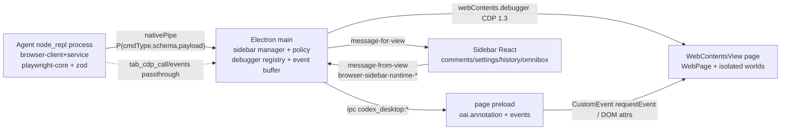
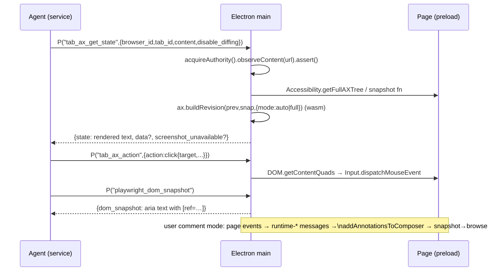

# SPEC — ChatGPT/Codex Desktop Internal Browser ("owl" IAB), 1:1 Replication Master Plan

Target: `D:\Projects\openAI code\OpenAI.Codex_26.1021.3705.0_x64__2p2nqsd0c76g0`
(app 26.1021.3705.0, plugin 26.1021.31345, codename "owl", MSIX Electron).
Companion deep-dives: `schemas-and-ipc.md`, `dom-snapshot-and-cdp.md`, `annotation-and-ui.md`,
`next-steps.md`, `session-log.md`. Extracted artifacts: `C:\Users\Ruku\AppData\Local\Temp\codex_re\`
(94 asar members, bodyBase=6,053,836, 21,791-entry index). Plugin canonical path:
`app/resources/cua_node/bin/node_modules/@oai/browser-desktop/` (scripts + environment-docs/{codex-app,cloud,orbit,training}).

## 1. Process & control architecture
Four cooperating planes:
1. **Agent runtime** — `node_repl` plugin process executes `agent.browsers` JS API
   (`@oai/browser-desktop` = `browser-client.mjs` front + `browser-service.mjs` 1.6 MB engine).
   Embedded playwright-core + zod; reaches Electron via `globalThis.nodeRepl.nativePipe`.
2. **Electron main** — hosts `WebContentsView` browser pages
   (`sandbox:!0, nodeIntegration:!1`, session `fromPartition(gu("app"),{permissionHandling:"browser",
   enableBrowserPolicies:!0})`), owns `webContents.debugger.attach("1.3")` refcounted registry
   `{users,browserUseUsers,childSessions,ownsAttachment,…}`, buffers CDP events, enforces site policy,
   runs annotation/composer state machine, overlay-window geometry (u$e/qH/JH/YH), clearData,
   autocomplete coordinator, downloads.
3. **Page world** — `browser-page-preload.js` injects `document.oai.annotation`, feature/webmcp events,
   annotation DOM contracts; `mcp-annotation-runtime.js` = hit-test/selection surface engine.
4. **Sidebar React UI (webview assets)** — comment editor cards, history, settings, omnibox overlay,
   profile import, clear-data dialog; receives `{type:…}` envelopes on `codex_desktop:message-for-view`.





## 2. Ten-point checklist coverage matrix
| # | Area | Where specified | State |
|---|------|-----------------|-------|
| 1 | Tool schemas + system instructions | schemas-and-ipc §2 + Appendix A/B (api.json, documents.json, env-docs verbatim) | DONE (4 env variants enumerated) |
| 2 | Main viewport/session manager, split-pane math, shortcuts | spec §1; annotation-and-ui §5 (u$e/qH/JH/YH), §7 accelerators | DONE-except chords (A6) |
| 3 | IPC contract + preload contextBridge | schemas-and-ipc §3–§4 (channel pool + 30 runtime types + sendSync policies) | DONE |
| 4 | DOM snapshot + deterministic ref engine | dom-snapshot-and-cdp §3–§4 + §3.0.1–3.0.3 (walker constants QX/eJ/tJ/rJ, budgets, ref registries `__browserUseVisibleDomState`/`yo`, eviction) | DONE (A1–A3 closed) |
| 5 | Per-tab state machine | schemas-and-ipc §2.2–§2.4 (turn meta, claim, cleanup docs) + closePage/transferConversation verbatim (annotation-and-ui log) | CORE DONE |
| 6 | Exact CDP dispatch | dom-snapshot-and-cdp §2, §5–§6 (method census, attach, quads→input, cdp capability) + §3.0.3 (`ux/Kne/Xne`, `pO/dO`, `Bs/Yy/Tp/qs`) | DONE (A3 closed) |
| 7 | `document.oai.annotation` + oai-* classes + custom hitTest | schemas-and-ipc §3.1–§3.2 + annotation-and-ui §3–§4 | DONE |
| 8 | Adjust/styling + comment→composer | annotation-and-ui §1–§2.3, §6 — `TEe` envelope, `JS` section builder, `ZS` per-comment block, `kEe` Adjust/styling, `EEe/$Te` response annotations, IAB ambient constants, app-shared mirror (`aoe as gFt`) | DONE (A5 closed) |
| 9 | Security policy engine | schemas-and-ipc §5 + §2.3 + dom-snapshot §6 + env-docs browser-safety/confirmations (appendix) | CORE DONE (allow/deny verified; A9 ask-state open) |
| 10 | Profile history, omnibox, clear data, agent history | spec §4 (eFe/searchHistory/topSites/yu clearData verbatim) + next-steps A7–A8, A11–A13 | ENGINE DONE; UI ranking open |

## 3. Evidence ledger (key claims)
| Claim | Label | Evidence |
|---|---|---|
| app.asar sha `04862a65…`, 21,791 entries, bodyBase 6,053,836 | verified | REA open_binary ev + asar_header.mjs JSON |
| engine runs in node_repl, not main | verified | handler registrations (`L("tab_…` / `L(Mi.Bundle` / `L(oe.WebMcp…`) occur only in browser-service.mjs; main embeds the client-SDK mirror (schemas/builders/capability factories, MAIN-D1..D6 of schemas-and-ipc Appendix D) but zero handlers; `nodeRepl.nativePipe` in service |
| tab capability command surface fully mapped | verified | Appendix D: 35 verbatim fragments; command→handler registry map [875221,877705); `var oe={};H(oe,{…})` namespace map [1057459,1059625); dispatch table `i3`; 3 registration styles; `tab_content_export` ns `_m` ships WITHOUT any service handler (0 hits `L(Sk,`/`L(_m,`/`L(oe.TabContentExport,`) — only GSuite+YouTube export handlers wired; `P` envelope class [1059635,1059803) ↔ main `NU` class [2628665,2628850) |
| `P(commandType, PayloadSchema, payload)` zod envelope | verified | qR/$R/p1/VR literals |
| turn metadata session_id+turn_id required | verified | `g5`/`RA` functions |
| debugger attach("1.3") + users/browserUseUsers registry | verified | main fragment |
| AX = CDP Accessibility + browser-accessibility.wasm.br (9 exports) | verified | exports list, buildRevision, FinalizationRegistry |
| Accessibility.* CDP calls present (corrects earlier census) | verified | 1× each enable/getFullAXTree/loadComplete/nodesUpdated |
| dom_cua line budget 2e4 chars/200 elements; credential frame 15k/150 | verified | oc/ic/nY/oY literals |
| snapshot mode "ai", `[ref=]`, `aria-ref=`, enter-frame control | verified | telemetry attrs + KN literal |
| oai install `Reflect.defineProperty(document,"oai",{…enumerable:!1…})` | verified | preload block |
| site facets access/downloads/uploads/full_cdp_access = allow\|deny | verified | policy chunk compare census |
| clearData map {cookies,siteData,cache,downloads,history,formData,siteSettings}+timeRange | verified | `function yu` verbatim |
| history: searchHistory(deduplicateByDay, alwaysPrefix, startTime, text, offset), topSites block/restore, getCacheSize, getDownloadHistory | verified | eFe class verbatim |
| geometry: viewport=contentBounds+browserBounds; workArea via getDisplayMatching; preview inset FH | verified | u$e/qH/JH/YH verbatim |
| Ctrl+Shift+B / Ctrl+T literal chords | **unknown** | menu emits `toggle-sidebar`; chords live renderer-side (A6) |
| third site-permission state (ask/auto) | **unknown** | A9 |
| comment composer text grammar | verified | main `TEe/JS/ZS/kEe/EEe` @1192033–1221000 + constants [1195122,1199642) (annotation-and-ui §2.3); prompt-context §2.2; app-shared mirror [406119,408203) + `aoe as gFt`; whole-asar scan = 5 `page-comment-context` hits |
| i.Br placement solver source | **unknown** | A10 |
| history storage backend (level vs sqlite) | **unknown** | A8 |
| request() payload of oai.annotation | **unknown** | preload `l(e)` validator window unread |

## 4. History / profile / clear-data (checklist 10) verbatim engine
```js
browsingHistory: eFe.create(e, ()=>b.getBrowserSession())   // DI wiring
eFe.clearBrowsingData(e){return yu(this.#e,e.dataTypes,e.timeRange)}
eFe.dismissTopSite(e){return this.#e.topSites.addBlockedUrl(e)}
eFe.restoreTopSite(e){return this.#e.topSites.removeBlockedUrl(e)}
eFe.getBrowsingDataSummary(e){ Promise.all([searchHistory({deduplicateByDay:!0,matchingAlgorithm:`alwaysPrefix`,
  maxResults:0,startTime:t,text:``}), cookies.get({}), getCacheSize?.(), getDownloadHistory()]) … hostname sets }
searchHistory(e){offset paging: r=maxResults??100; … o.filter(wD); grow i+=r until fill; s.slice(t,…)}
function yu(e,t,n){ types cookies|siteData(Qse when no timeRange)|cache|downloads|history|formData|siteSettings
  → e.clearData({dataTypes:r, timeRange:n?}) }
// autocomplete:
browserAutocompleteCoordinator=new xPe((e,t)=> t.surface===`composer`
  ? n.autocomplete.createController(va().browserExtensions&&e?.session===n?e:void 0) : n.aut…)
browserAutocomplete:new wPe(coordinator, e)   // omnibox surface ranking [renderer A7]
```
Profile import: renderer chunk `codex_browser_profile_import`; MCP-app sessions
`/[a-f0-9]{48}$/` + `{persist:!0}` + clearData/storagePath (spec §1). Agent-tab turn cleanup per
docs (appendix): turn-scoped `markDeliverable`/`markHandoff`, claims released at turn end.

## 5. Ruke WebUI blueprint → `lib/browser/`
Layout (Next.js + Electron host in this repo; keep viewers lazy — CLAUDE.md §5):
```
lib/browser/
  engine/{commands.ts, transport.ts, cdpBridge.ts, domCua.ts, ax.ts, pw.ts}   # dom-snapshot-and-cdp §8
  security/{authority.ts, sitePolicy.ts, blocklists.ts, confirmations.ts}     # schemas-and-ipc §2.3/§5
  session/{profile.ts, history.ts, clearData.ts, autocomplete.ts, downloads.ts}
  annotation/{pageRuntime.ts, surfaces.ts, placement.ts, composerBridge.ts, contextMenu.ts}
  ipc/{channels.ts, runtimeTypes.ts}   # literal codex_desktop:* + browser-sidebar-runtime-* tables
```
Non-negotiable 1:1 contracts: wire command names & snake_case payloads; `[ref=]`/`node_id=` line
grammars; `document.oai` install semantics (enumerable:!1, Reflect-guarded); attribute constants;
30 runtime message types + 24 channels; allow/deny facet names; clearData type set; history query
option names; geometry field names. Deviations (portable): wasm AX → JS port if text output matches;
`i.Br` solver reimplementation; nativePipe → app socket. Sequencing per next-steps.md §C with
CODE/TEST/ANALYZE locks.

## 6. Risk & fidelity notes
- Vendored playwright-core version pinning matters: `aria-ref`, `internal:control=enter-frame`,
  mode:"ai" snapshot format must match; snapshot target `body_or_document`.
- Event ring buffer semantics (sequence/hasMore/truncated) are load-bearing for `tab_cdp_events`.
- Prompt-injection hardening: all page/agent content treated as data (mirrors REA posture);
  `acquireAuthority().observeContent(url).assert()` gate precedes every command.
- No telemetry/remote blocklist parity required locally, but keep `commentModeBlocklistLookup` seam.
